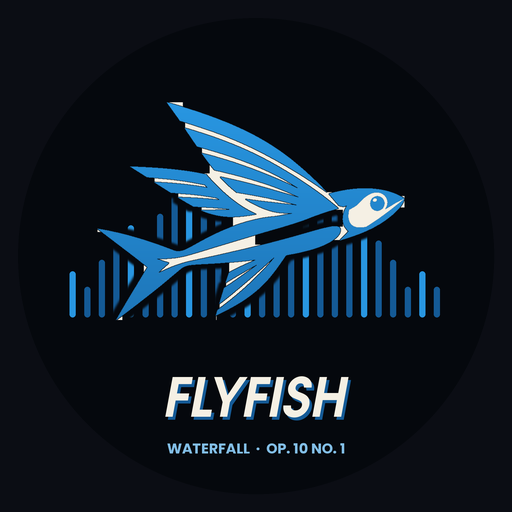
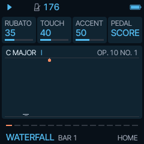
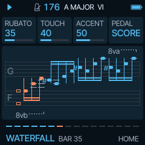
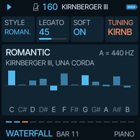
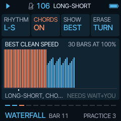

# Flyfish

**Waterfall Flying Fish**: one piece on the M-VAVE FM-1, Chopin's Étude in C major, Op. 10 No. 1. Flyfish plays it,
lets you shape it, practise it and move it, on a sampled Steinway D. Built on [Tuna](https://github.com/delirioux/tuna)
and [Felucca](docs/FELUCCA.md).

## Why this piece

Because of the film *Youri*. It opens with this étude, and Flyfish began the evening after watching it: to have
that music in a pocket synth, to play it, to learn it, to make it fall like water.

> **Version 1.0.** Built for love of one piece, with no warranty. Felucca's or Tuna's installer, or the official V15,
> takes the FM-1 back.

## Install

Open **[delirioux.github.io/flyfish](https://delirioux.github.io/flyfish/)** in Chrome or Edge on a computer, connect
the FM-1 with a USB data cable and press Install (allow MIDI when the browser asks). The page checks the package in
the browser and writes it over USB-MIDI, as Felucca's installer does. Flyfish keeps its settings and practice chart
in Felucca's first two song slots: back up anything you made in Felucca first.

Test builds: every push to `dev` leaves a package in the GitHub run's artifact `flyfish-firmware`; the installer's
"Install a test build" takes it. From a terminal: `python3 tools/fm1_install.py flyfish-X.Y.fwsc`.

## Five ways into one piece

- **Play.** Press PLAY: all 79 bars, from the first C to the last. ROUNDS (ARP) sets how often it goes round: INF,
  the default, goes on for ever through a seam you will not hear (bar 48 runs into bar 1 as it runs into the
  recapitulation, which is bar 1 again); 1 plays it once and stops.
- **Perform.** RUBATO lets the pulse breathe with each two-bar wave; TOUCH sets how far the dynamics move; ACCENT
  brings out Chopin's accents and each wave's crest; PEDAL is the score's (a new pedal where the bass changes),
  HALF, DRY or WASH. The pedal's ring is a resonator of sympathetic strings tuned to the harmony.
- **Practise.** SPEED down to 25 %, a loop of any bars (REC), RAMP to speed up a little every round, a CLICK and a
  bar's count-in. Leave a hand out (YOU) and play it yourself: FREE along with the music, TAP (each key plays the
  next note: you are the rhythm) or WAIT (the music waits for the right note, any octave; the keys light up). Drill
  it as teachers do: RHYTHM in dotted pairs (LONG-SHORT, SHORT-LONG) or with the accent on the 2nd, 3rd or 4th note
  of each group, and CHORDS, each group of four as one chord, to learn the hand's shapes before the run. In WAIT a
  chart keeps each bar's best clean SPEED and its wrong keys.
- **Move it.** The notes are always Chopin's. Move them to another KEY, play them in MINOR, DORIAN or LYDIAN, change
  the BASS (OCTAVE, SINGLE, DRONE, NONE).
- **Chopin's piano.** A STYLE sets a whole reading at once: CLASSIC, ROMANTIC, VIRTUOSO or NOCTURNE. LEGATO sets how
  far each note of the figures overlaps the next; SOFT is the una corda; PLEYEL voices the Steinway after the piano
  Chopin played. TUNING is equal temperament, or for contrast two 18th-century well temperaments (Kirnberger III,
  Vallotti); PITCH is A = 440, 435 (the diapason normal of 1859) or 430 Hz. The screen names the harmony in Roman
  numerals (V7/V, viio7/ii) and can show the bar as a score.

Nine sounds on Felucca's engines: GRAND (a Steinway D, sampled), PLEYEL (the same Steinway voiced darker, quicker
and lighter: a voicing, not a recording of a Pleyel), TINE EP, HARP, CELESTA, MUSIC BOX, KALIMBA, MARIMBA, SINE KEY.
The piano in stereo (the bass left, the treble right), three spaces of reverb (CATHEDRAL at 25 % to start), ten
colours.

## The controls

| | |
| --- | --- |
| SELECT | tempo (the score: ♩ = 176) |
| MASTER | volume |
| PRESETS | the sound, on any page |
| ALGORITHM | a bar to go to (playing: at the next bar line) |
| KNOB 1-4 | the four cards on the screen |
| PLAY | start / stop |
| REC | the loop FROM .. TO on and off |
| OCT- / OCT+ | a bar back / on |
| HOME | RUBATO TOUCH ACCENT PEDAL, the waterfall (or the score); hold it: MENU (COLOR LOOK VIEW PITCH) |
| EDIT | sound: SOUND BRIGHT DECAY WIDTH |
| SEQ | practice: SPEED FROM TO YOU; again: MODE RAMP CLICK COUNT; again: RHYTHM CHORDS SHOW ERASE (turn it twice) |
| ARP | variations: KEY MODE BASS ROUNDS |
| GLO | mix: RIGHT LEFT REVERB SPACE |
| FX | piano: STYLE LEGATO SOFT TUNING |
| keys | music only: playing along, tapping, finding the note |

MIDI out: the right hand on channel 1, the left on 2, the keys on 3; the sustain pedal (CC64, lifted where the bass
changes and put down again 30 ms later) and the soft pedal (CC67) on 1 and 2, so Flyfish can play a real piano. The
temperament and pitch stay in Flyfish's own sound. The settings save themselves while stopped.

## The notes

[`data/op10no1.txt`](data/op10no1.txt) holds the étude as Chopin wrote it: 1,337 notes, pitches and rhythms only,
one a line, checked against a public-domain score. The dynamics, the pedal and the rubato are Flyfish's own reading
of the score's markings (f, cresc., dim., the hairpins, the accents, Ped.), not anyone's recording.

## Building

As Tuna (see [BUILDING.md](BUILDING.md)), with `FELUCCA_FLYFISH=1 ./build.sh`. GitHub Actions builds every push to
`main` and `dev` and publishes the site with the installer (`web/ff_make_site.py`), marked a test build when it comes
from `dev`. The repository needs Settings > Pages > Source: GitHub Actions, and `dev` allowed under Settings >
Environments > github-pages. `sh tests/ff_tests.sh` runs the host tests;
`sh tests/ff_felucca.sh OUTDIR` renders the étude through Felucca's engines to a WAV. Design notes:
[docs/DEVELOPMENT.md](docs/DEVELOPMENT.md).

## Credits and licence

GPL-3.0-only. Flyfish by delirioux, written with Claude; a fork of Tuna (delirioux), a fork of Felucca by Leo
Kuroshita, Hügelton Instruments; the web installer is Felucca's. Chopin's notes are in the public domain; the piano
is a Steinway D from Princeton's bitKlavier Grand Sample Library by Daniel Trueman (CC BY 4.0). See
[CREDITS.md](CREDITS.md) and [LICENSING.md](LICENSING.md).
